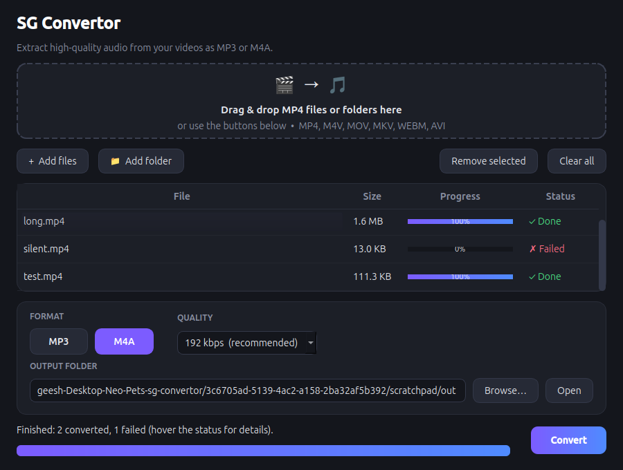

# SG Convertor

A small desktop app that extracts the audio from MP4 videos and saves it as **MP3** or **M4A**.

## Why

I have plenty of music, talks and podcasts saved as MP4 videos, but my MP3 player only plays
audio files. SG Convertor turns those videos into audio files the player understands, so I can
copy them across and listen on the go. No command line, just drag, drop and convert.

The project is just getting started, and more features are planned.



## Features

- Drag & drop files or whole folders (searched recursively), or use the file pickers
- Converts MP4, M4V, MOV, MKV, WEBM and AVI
- MP3 (LAME) or M4A (AAC) output at 96–320 kbps
- Batch conversion with per-file and overall progress
- Save next to each video or into a folder of your choice
- Never overwrites: existing names get a suffix such as `song (1).mp3`
- Cancel at any time; partial files are cleaned up
- Clear failure reasons (hover a "Failed" status), e.g. videos with no audio track
- ffmpeg is bundled through [`imageio-ffmpeg`](https://github.com/imageio/imageio-ffmpeg), so nothing needs installing system-wide

## Requirements

- [uv](https://docs.astral.sh/uv/getting-started/installation/)

uv downloads a suitable Python and all dependencies for you.

## Getting started

```bash
uv sync                 # create .venv and install dependencies
uv run sg-convertor     # launch the app
```

`uv run python -m sg_convertor` works too.

### Install as a command

To have `sg-convertor` available everywhere without activating anything:

```bash
uv tool install .
sg-convertor
```

## Usage

1. Drop videos onto the window, or click **Add files** / **Add folder**.
2. Pick **MP3** or **M4A** and a quality. 192 kbps is a good default; choose 320 kbps for the best quality.
3. Optionally choose an output folder. When empty, each audio file is written next to its video.
4. Click **Convert**. Use **Open** to jump to the output folder when it finishes.

## Development

```bash
uv sync                    # includes the dev group (pytest, ruff)
uv run pytest              # run the test suite
uv run ruff check .        # lint
uv run ruff format .       # format
```

The tests generate short clips with the bundled ffmpeg and run real conversions, so they need no
fixtures on disk. Qt runs with the `offscreen` platform, so they also work without a display.

### Project layout

```
src/sg_convertor/
├── app.py              # entry point: creates the QApplication and main window
├── models.py           # AudioFormat, ConversionSettings, bitrate options
├── files.py            # finding input videos, choosing non-clashing output paths
├── ffmpeg.py           # building ffmpeg arguments and parsing its output (pure functions)
├── converter.py        # BatchConverter: runs ffmpeg via QProcess, reports progress by signals
└── ui/
    ├── main_window.py  # composes the widgets and connects them to the converter
    ├── drop_zone.py    # drag & drop target
    ├── file_table.py   # file list with per-row progress and status
    ├── settings_panel.py  # format, quality and output-folder controls
    └── styles.py       # colour palette and Qt stylesheet
tests/                  # pytest suite
```

Dependencies only point downward: `ui` → `converter` → `ffmpeg` / `files` → `models`.
Everything below `ui` is free of widgets, and everything below `converter` is free of Qt,
which keeps the conversion logic easy to test.


## How it works

For each file the app runs ffmpeg roughly like this:

```bash
ffmpeg -i input.mp4 -vn -map 0:a:0? -c:a libmp3lame -b:a 192k -progress pipe:1 output.mp3
```

`-vn` drops the video, `-map 0:a:0?` takes the first audio track, and `-progress pipe:1` streams
the encoding position, which is compared with the input's duration to drive the progress bars.
Conversions run one at a time in a `QProcess`, so the window stays responsive.
